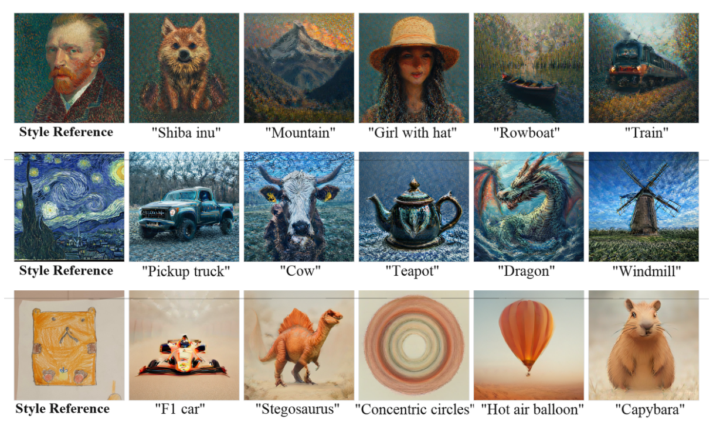
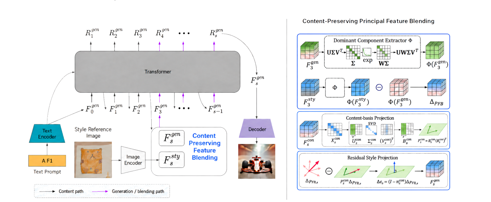
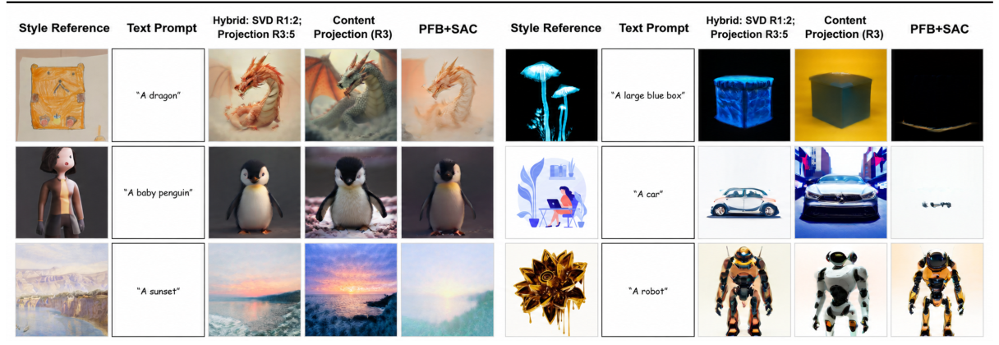

**[📄 arXiv Paper](https://arxiv.org/abs/2611.00683)** · **[🌐 Project Page](https://leehoang2710.github.io/CoPFB/)** · **[💻 Code](https://github.com/HNg0303/CoPFB)**

## Overview

**CoPFB** (Content-Preserving Principal Feature Blending) is a **training-free** method for reference-based style personalization in **visual autoregressive (VAR) models**. The goal is to transfer the appearance of a style reference while keeping the subject, geometry, and composition dictated by the content prompt.



## 🎯 Motivation

Principal feature blending is an effective way to inject a reference style into generation, but the dominant reference features often carry **object and spatial information** as well. Injecting them directly causes **content leakage**: the generated image drifts toward the reference's subject or layout instead of following the prompt.

## 🔧 Technical Approach



1. **Build a clean content basis**: extract dominant channel directions from the unmodified generation stream.
2. **Form the PFB residual**: compare style-reference and generation features through the same reconstruction.
3. **Remove aligned components**: project the residual away from the content basis to suppress content leakage.
4. **Blend by scale**: apply rank-one blending at the first two autoregressive scales, weaker content-projected refinement at the next three scales, and no injection at later scales.

## Key Contributions

* A training-free approach that estimates a **low-rank content basis** from a clean generation branch.
* **Content projection** that removes the content-aligned component of the style residual.
* A **hybrid multi-scale schedule** combining early edits, content-filtered refinement, and SAC-based structural guidance during later refinement.
* An analysis of **scale-wise dynamics** in VAR generation that motivates scale-dependent control.

## 📊 Results

Evaluated on 1,900 combinations of **Parti** content prompts and **FineStyle** reference images, with identical prompts, references, seeds, and sampling settings:

| Method | Text ↑ | Image ↑ | Harmonic ↑ | Time ↓ |
|---|---|---|---|---|
| PFB + SAC | 0.293 | **0.590** | 0.391 | 3.8 ± 0.6s |
| Content Projection (R3) | 0.295 | 0.561 | 0.387 | 1.9 ± 0.3s |
| **CoPFB Hybrid** | **0.297** | 0.577 | **0.393** | **2.0 ± 0.2s** |

Compared with PFB + SAC, CoPFB improves text alignment from 0.293 to 0.297 and the harmonic score from 0.391 to 0.393 (style similarity decreases from 0.590 to 0.577), while cutting inference time from about 3.8 to 2.0 seconds per image. CoPFB requires no fine-tuning or learnable parameters.



## Citation

```bibtex
@inproceedings{bui2026copfb,
  title     = {Content-Preserving Principal Feature Blending for Training-Free Style Personalization},
  author    = {Le-Hoang Bui and Hoang-Nguyen Cao and Trung-Nghia Le and Minh-Triet Tran and Dinh-Khoi Vo},
  booktitle = {Proceedings of SOICT 2026},
  year      = {2026}
}
```
